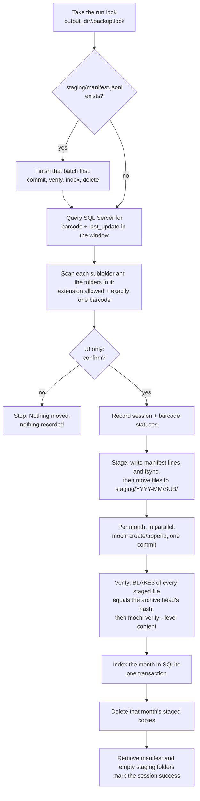

# How it works

This page explains what one backup run does, what it leaves on disk, and why a
crash at any point loses nothing. For the code itself, see
[code-walkthrough.md](code-walkthrough.md).

## One run



### The date window

| Case | Window |
|---|---|
| `date_range` set in the config | Exactly that range. |
| First run ever | Everything before `today - lookback_days`. |
| Later runs | From the last successful run's end date minus 1 day, up to `today - lookback_days`. |

Because the start comes from the index, runs can be daily, weekly or whenever
you like. A run always covers the gap since the last success, and the 1-day
overlap catches rows that arrived late.

### Which files match

A file in `<source_dir>/<SUBFOLDER>/`, or in any folder below it (`"recursive": true`, the
default; `false` scans only the subfolder itself), matches when:

1. its extension (after the last `.`) is in `extensions` (case does not matter), and
2. its name contains **exactly one** candidate barcode that has `_`, `.`, `-`,
   or the start or end of the name on both sides.

`BC123` matches `unit1_BC123_log.txt` but not `unit1_BC1234_log.txt`. A name
that contains two different barcodes is ambiguous: it is counted as an error and
left alone.

The archive month is the barcode's `last_update` month from SQL Server, not
today's month.

The scan never enters the staging or output folders (even if they sit inside a
subfolder) and does not follow links. A folder it cannot read is skipped with a
warning and counted as an error; the rest of the scan goes on. Only the file name
is matched, not the names of the folders above it.

## What it leaves on disk

```
<output_dir>/
  2026/
    2026-07.mochi            one archive per month
    2026-08.mochi
  .backup.lock               run lock (empty file, safe to ignore)
<source_dir>/
  .staging/                  only during a run, or after an interrupted one
    manifest.jsonl
    2026-08/BURNIN/unit1_BC001_log.txt
<db_path>                    SQLite index (default name in the example: index.db)
backup.log                   full run log, written by backup_ui.py next to config.json
```

### Inside an archive

A `.mochi` file is an append-only chain of commits. Each run adds **one commit**
to each month it touched. Paths inside are `<SUBFOLDER>/<filename>`, with any folders
between them kept (`BURNIN/line2/2026-08/unit3_BC001_log.txt`). A later file in a folder
the archive already has is added to that folder; the earlier files stay:

```
2026-08.mochi
  commit 0  BURNIN/unit1_BC001_log.txt, ESS/unit2_BC001.txt, ...
  commit 1  (next run) ESS/late_BC001.txt
```

Each file is stored with its original modification time (moving into staging
keeps it). MOCHI compresses and deduplicates by itself.

### The SQLite index

The same schema as Finisar_move_log_files (`PRAGMA user_version = 2`):

| Table | One row per | Key columns |
|---|---|---|
| `scan_session` | run | `status` (running / success / failed), `query_from_date`, `query_to_date`, totals |
| `session_barcode` | barcode + `last_update` seen | `status` (matched / no_files_found). Unique on `(barcode, last_update)`, so a barcode is recorded once. |
| `file_storage_volume` | monthly archive | `path`, `volume_name` (`YYYY-MM`), `file_size`, `head_commit_id`, `head_seq`, `entry_count` |
| `scanned_log_entry` | archived file | `barcode`, `relative_path`, `content_hash` (BLAKE3, what `b3sum` prints), `commit_seq`, `original_size`. Unique on `(relative_path, file_storage_volume_id)` |

An index from the old tar.zst format, or with another version, is refused and
left untouched. Move it aside and a new one is created.

### The manifest

`staging/manifest.jsonl` records what is in staging and why. The first line is
the session, then one line per file:

```
{"scan_session_id": 42}
{"relative_path": "BURNIN/unit1_BC001_log.txt", "source_subfolder": "BURNIN", "barcode": "BC001", "original_size": 18234, "volume_name": "2026-08"}
```

## Why nothing is lost

**Rule: a file is always in exactly one place, the source folder, staging, or
a verified archive.**

| Moment of the crash | State afterwards | What the next run does |
|---|---|---|
| During the scan | Nothing moved | Normal run |
| While staging | Manifest lines are synced **before** their files move, so every file in staging is listed. A listed file that never moved is still in the source. | Finishes the staged files. Files still in the source are picked up by the scan. |
| During `mochi` commit | MOCHI publishes nothing half-written. The next `append` may refuse with `UNCOMMITTED_TAIL` (see [operations.md](operations.md#troubleshooting)). | Retries the commit, or stops and asks a person to repair the tail |
| After commit, before index | Files are in the archive **and** in staging | Sees every staged file already in the archive head with the same hash, so it makes **no new commit**, then indexes and deletes |
| After index, during deletes | Some staged copies remain | Commits nothing new for them, re-indexes (an upsert), deletes |

Also:
- **Never overwrite.** A file is not moved into staging if that staging path is already taken.
- **Verify before delete.** A month's staged copies are deleted only after: every
  staged file's BLAKE3 equals the archive head's hash for that path, `mochi verify
  --level content` passes, and the SQLite transaction committed.
- **Months are independent.** A month that fails keeps all its staged files. Other
  months still finish. The run then reports failure and the next run resumes only
  what is left.
- **Unknown files are kept.** Anything in staging that is not in the manifest is
  never deleted. It is reported and counted as an error.
- **One run at a time.** `.backup.lock` is held for the whole run. The operating
  system releases it when the process ends, even after a crash.

## Words used in messages

A successful write is **committed (LOCAL_COMMITTED)**: one local archive file
was written and synced. That is not a backup on its own. Keep an independent
copy of `output_dir` and the index (see [operations.md](operations.md#moving-to-another-pc-what-to-copy)).
A `DEGRADED (not an error)` warning after a commit means the data is committed
but the folder entry was not confirmed durable. MOCHI always reports this for a
new archive on Windows.
